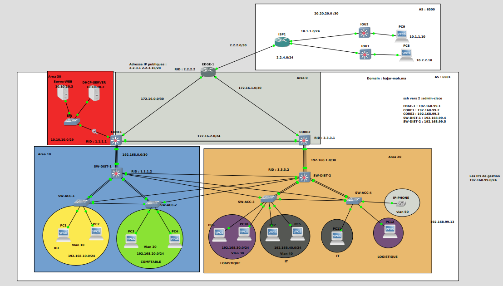

# Projet : Architecture Réseau d’Entreprise Multi-Zones avec OSPF, VLAN et Accès Internet

## 🧠 Présentation du projet

Ce projet présente une **architecture réseau d’entreprise hiérarchique, sécurisée et hautement disponible**, conçue pour répondre aux exigences modernes des **entreprises intelligentes (Smart Enterprise)** :

- haute disponibilité
- segmentation réseau
- sécurité renforcée
- performance
- évolutivité
- support de la voix et des données
    
L’architecture repose sur un **design Campus 3-Tiers (Core / Distribution / Access)** avec intégration WAN, sécurité périmétrique et interconnexion avec un fournisseur Internet (ISP).

## Schéma global de l’architecture




## 🧩 Description générale

Ce projet consiste à concevoir et simuler une **architecture réseau d’entreprise hiérarchique**, sécurisée et scalable, intégrant :

- Un **cœur de réseau redondant**
- Plusieurs **zones OSPF**
- Une **segmentation par VLAN*
- Des **services internes (DHCP, Web)**
- Une **connexion Internet via un routeur EDGE**
- Une séparation **LAN / WAN / DMZ**
- Une gestion centralisée et sécurisée des équipements

Le projet est conçu dans un contexte **réseau d’entreprise moderne**, avec une approche réaliste proche des environnements professionnels.


---

## Architecture globale

###  Modèle hiérarchique (Campus Network)

L’architecture est basée sur le **modèle hiérarchique Cisco** :

|Couche|Rôle|
|---|---|
|**Core**|Haute performance, routage rapide, backbone du réseau|
|**Distribution**|Politique réseau, redondance, routage inter-VLAN|
|**Access**|Connexion des utilisateurs, VLAN, QoS, sécurité locale|

### 🔹 Découpage logique

|Zone|Description|
|---|---|
|**Area 0**|Backbone OSPF – interconnexion cœur/edge|
|**Area 10**|Réseau utilisateurs (RH, Comptabilité)|
|**Area 20**|Réseau utilisateurs (IT, Logistique, Téléphonie IP)|
|**Area 30 (DMZ)**|Serveurs (Web, DHCP)|
|**AS 6501**|Réseau de l’entreprise|
|**AS 6500**|Fournisseur d’accès (ISP)|

---

## Plan d’adressage IP
### 🔸 VLANs Utilisateurs

|VLAN|Département|Réseau|
|---|---|---|
|VLAN 10|RH|192.168.10.0/24|
|VLAN 20|Comptabilité|192.168.20.0/24|
|VLAN 30|Logistique|192.168.30.0/24|
|VLAN 40|IT|192.168.40.0/24|
|VLAN 50|Téléphonie IP|192.168.50.0/24|
### 🔸 Réseau de gestion

|Usage|Réseau|
|---|---|
|Management (SSH, supervision)|192.168.99.0/24|

---
## 🖧 Équipements réseau

### 🔹 Routeurs

|Nom|Rôle|RID|
|---|---|---|
|EDGE-1|Accès Internet / frontière AS|2.2.2.2|
|CORE1|Cœur de réseau|1.1.1.1|
|CORE2|Cœur de réseau (redondance)|3.3.3.3|
|ISP1|Fournisseur Internet|—|

---
### 🔹 Switchs
- **SW-DIST-1 / SW-DIST-2** : Distribution (L3)
- **SW-ACC-1 à SW-ACC-4** : Accès utilisateurs
- **SW (DMZ)** : Accès serveurs
    
---
## Routage

### ✔️ OSPF (IGP)
- OSPF multi-aires
- Area 0 comme backbone
- Redistribution contrôlée vers l’EDGE
- LSDB cohérente par zone
- Séparation logique des flux
    
---

### 🌍 Accès Internet
- Connexion via **EDGE-1**
- IP publiques : `2.2.3.1 – 2.2.3.16 /28`
- Routage inter-AS (AS 6501 ↔ AS 6500)
- NAT possible 

---
## 🛡️ Sécurité
- **Segmentation réseau par VLAN**
- **DMZ dédiée** pour les services exposés
- Accès **SSH sécurisé**
- Comptes d’administration restreints
- Possibilité d’intégration :
    - ACL    
    - Firewall (pfSense possible)    
    - IDS/IPS (extension future)   

---
## Services réseau
### 🖥️ Serveurs

|Service|IP|
|---|---|
|Web Server|10.10.10.3|
|DHCP Server|10.10.10.2|

---
### Téléphonie IP
- VLAN dédié (VLAN 50)
- Séparation data / voix
- Compatible QoS (extension future)
    
---
## 🔐 Accès d’administration

```text
Utilisateur : admin-cisco
Accès SSH v2

EDGE-1   : 192.168.99.1
CORE1    : 192.168.99.2
CORE2    : 192.168.99.3
SW-DIST-1: 192.168.99.4
SW-DIST-2: 192.168.99.5
```

---

## 🧪 Objectifs pédagogiques

- Comprendre **OSPF multi-aires**
- Maîtriser la **segmentation VLAN**
- Concevoir une **architecture hiérarchique**
- Mettre en œuvre une **DMZ**
- Gérer un réseau **multi-AS**
- Approche réaliste orientée **entreprise**
  

---

## 📌 Outils recommandés

- GNS3 / Packet Tracer
    
- Cisco IOS
    
- Wireshark
    
- pfSense (optionnel)
    

---

## Auteur

**SRHIRI HAJAR & Mohamed Traoré**  
Etudiant Ingénieur en systèmes communicants & sécurité numérique  
Projet académique – Réseaux Intelligents

